<h3 align="center">Python-first ● Laravel & Odoo backends ● Vue/Nuxt (TS) frontends ● Flet apps</h3>

    ​ ​
    ​ ​
    

---

### ＃ About Me
▎∅  **Python Specialist** ⌱ automation tools, APIs, and Android apps with Flet 
▎∅ **Backend Engineer** ⌱ Laravel, Django, and Odoo ERP customizations 
▎∅ **Frontend Developer** ⌱ performant UIs with Vue 3 + Nuxt 4 (TypeScript) 
▎∅ **Open-Source** ⌱ encryption utilities, UI components, and dev tools 
▎∅ **Systems** ⌱ Bash scripting, Linux workflows, advanced configs 
▎∅ **Security-minded** ⌱ secure, robust, scalable solutions 
▎∅ **Vision** ⌱ professional-grade tools that solve real problems 
Currently: fullstack, Vue/Nuxt frontend focus, open to small freelance work.  

 

### ＃ ACTIVITY

  
  

 
 
### ＃ Tech Stack
<table width="100%">
  <tr>
    <td></td>
    <td><b>▎PYTHON …</b> automation, APIs, Telegram bots, Android apps</td>
  </tr>
  <tr>
    <td></td>
    <td><b>▎FLET …</b> cross-platform Python UIs</td>
  </tr>
  <tr>
    <td></td>
    <td><b>▎VUE …</b> component-driven interfaces</td>
  </tr>
  <tr>
    <td></td>
    <td><b>▎NUXT …</b> SSR frontends in TypeScript</td>
  </tr>
  <tr>
    <td></td>
    <td><b>▎LARAVEL …</b> backend services, API layers</td>
  </tr>
  <tr>
    <td></td>
    <td><b>▎DJANGO …</b> <i>ex-stack</i>, backend prototypes, the web entry point</td>
  </tr>
  <tr>
    <td></td>
    <td><b>▎ODOO …</b> <i>ex-stack</i>, ERP customizations, business logic</td>
  </tr>
</table>

 

### ＃ Work & Availability
Limited internet in my region + focus on private repos = slower responses and public updates. I'm still committed to open-source. just expect delays.

 

### ＃ Selected Projects
▎<a href="https://github.com/Kourva/CornHub"><b>１ CornHub ⎋﹕</b></a> content platform with a playful UI 
▎<a href="https://github.com/Kourva/FletGrm"><b>２ FletGrm ⎋﹕</b></a> Telegram-style client built with Flet 
▎<a href="https://github.com/Kourva/AwesomeChatGPTBot"><b>３ AwesomeChatGPTBot ⎋﹕</b></a> ChatGPT integration for Telegram 
▎<a href="https://github.com/Kourva/V2rayDoprax"><b>４ V2rayDoprax ⎋﹕</b></a> proxy deployment tooling 
▎<a href="https://github.com/Kourva/AwesomeBadges"><b>５ AwesomeBadges ⎋﹕</b></a> badge collection used across my repos 

 

### ＃ STREAK

  

 

### ＃ Production Work

Not demos, production systems. I've shipped national-scale platforms, internal tools, and fullstack products: a multi-language therapy platform for kids, teens, adults, and couples; three separate Vue applications for the National Iranian Gas Company (CRM, PWA, and a reward-based engagement app), each with its own visual identity; a reservation-first cafe system built around consultants and brokers; and a professional qualification platform that maps career gaps and tells users exactly what to learn next. Alongside these I've delivered a long tail of smaller builds, cafe PWAs, dental clinic PWAs, online shops, and assorted internal tools, but the four below are the ones that ran at real scale. Some public, some behind closed doors. All of them built to run.

<table width="100%">
  <tr>
    <td><b>▎ASAYROOM</b></td>
    <td>Vue 3 + Nuxt 4</td>
    <td>Therapy platform, national scale, multi-language, video verification, wallets, assessments</td>
  </tr>
  <tr>
    <td><b>▎NIGC</b></td>
    <td>Vue 3</td>
    <td>Three internal apps, CRM, PWA, GAZIOM, multi-theme, unique design each</td>
  </tr>
  <tr>
    <td><b>▎CAFE MAHOUR</b></td>
    <td>Nuxt 3</td>
    <td>Reservation-first cafe system, table packages, two-level admin, full restaurant flow</td>
  </tr>
  <tr>
    <td><b>▎BAAM</b></td>
    <td>Nuxt 4</td>
    <td>Professional qualification platform, resume builder, gap analysis, learning suggestions</td>
  </tr>
</table>

**☍** [**kourva.github.io**](https://kourva.github.io/): full write-ups

 

### ＃ Contact
Best way to reach me. Email and Telegram. 
〓 **Portfolio ━** [**kourva.github.io**](https://kourva.github.io/) 
〓 **GitHub ━** [**github.com/Kourva**](https://github.com/Kourva) 
〓 **Email ━** [**realkourva@proton.me**](mailto:realkourva@proton.me) 
〓 **Telegram ━** [**@k0urv4**](https://t.me/k0urv4) 
〓 **Instagram ━** [**@k0urv4**](https://instagram.com/k0urv4) 
